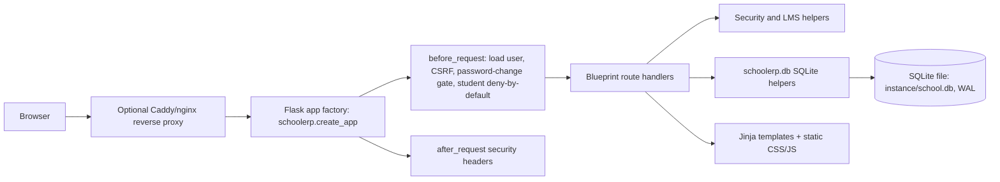
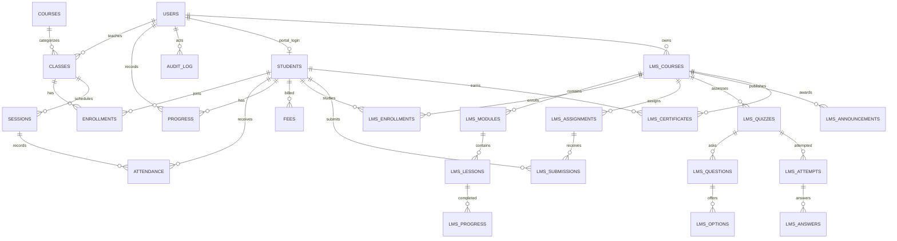

# Phase 0 — Baseline audit

**Audit date:** 2026-11-01  
**Scope:** Read-only review of the current Flask/SQLite v0.2 repository, including `README.md`, `CHANGELOG.md`, all files under `schoolerp/`, and the test suite. No application code was changed. This is a code review, not a penetration test or legal assessment. Severity describes risk in the current intended single-school deployment; multi-tenancy and internet-facing SaaS would raise several findings.

## 1. What I did

- Read the app factory, configuration, SQLite schema and LMS migration, helpers, all route modules, templates/static assets, README/changelog, and tests.
- Mapped the route authorization patterns and data model, reviewed security controls against OWASP Top 10 (2021) and ASVS Level 2 themes, and assessed code quality and scaling limits.
- Ran the 52-test suite. Attempted `ruff`, `bandit`, and `pip-audit`; those tools are not installed in this environment.
- Left the pre-existing working-tree changes untouched. The repository already had modifications and untracked v0.2 files when the audit began.

## 2. Architecture map

### Components and request flow



`app.py` is the Vercel WSGI entrypoint. `schoolerp/__init__.py` constructs the Flask app, registers the `auth`, `dashboard`, `students`, `staff`, `academics`, `attendance`, `reports`, `fees`, `audit_view`, `lms`, `learn`, and public certificate blueprints, and installs CLI commands. Route functions issue parameterized SQL directly through `schoolerp.db`; `security.py` supplies decorators and common object checks. Jinja autoescaping and `utils.py`'s CSV/link/text helpers handle output. There is no separate service or repository layer, API, worker, cache, or email service.

### Data model



The core schema is in `schoolerp/schema.sql`; `schoolerp/migrations/002_lms.sql` rebuilds the users table to permit the `student` role and adds the student portal link and LMS tables. There are status/enum checks, foreign keys, uniqueness constraints, and indexes for several lookup paths. This is a single-school schema: there is no tenant entity or tenant key on records.

## 3. Security review

### Positive controls observed

- Password hashes use Werkzeug's scrypt default (`schoolerp/security.py:48-49`); generated credentials are temporary, shown in the response, and force a password change.
- Secure, HttpOnly, SameSite cookies are configured outside development; users have an idle timeout and a token version used to revoke sessions on password change, deactivation, and role change (`schoolerp/__init__.py:23-30`, `schoolerp/security.py:103-117`). Login clears the previous session.
- Every mutating HTTP method requires a session CSRF token; an Origin host check is also applied where the header exists (`schoolerp/security.py:91-99`). Logout is POST-only.
- Route decorators and object checks scope teacher access to owned classes/students and owned LMS courses. Student accounts are centrally restricted to the learner/public/auth/static blueprints. Existing tests cover several IDOR cases.
- SQL values are bound as parameters. Templates use autoescaping; lesson text is escaped; video embeds are allow-listed. CSV output neutralizes formula-leading characters (`schoolerp/utils.py:98-113`).
- CSP, HSTS when secure cookies are active, no-store response caching for non-static pages, and other browser security headers are set (`schoolerp/security.py:225-239`).
- SQLite enables foreign keys per connection, and migrations make a consistent backup before upgrade and run a foreign-key check (`schoolerp/db.py:11-16,44-70`).

### Findings

| ID / severity | Location | Finding and plausible impact | Recommended remediation |
|---|---|---|---|
| F-01 **High** | `schoolerp/schema.sql:34-51,131-142`; throughout routes | **No tenant boundary exists.** All business tables are global, and authentication has only school roles. Deploying this code for multiple schools would expose one school's students, guardian contacts, classes, attendance, fees, LMS work, and audit records to another school's staff. | Treat tenant isolation as a prerequisite to SaaS. Add tenant ownership to every tenant-owned table, central scoping, PostgreSQL RLS, tenant resolution, and overlapping-ID cross-tenant tests before onboarding a second school. |
| F-02 **High** | `schoolerp/security.py:91-99` | **CSRF Origin validation checks only `netloc`.** It ignores scheme, so `http://same-host` passes on an HTTPS origin; absent Origin is accepted if the CSRF token is valid. The token is the main defense, but this weakens defense-in-depth and proxy/host assumptions matter. | Compare normalized full origins against the configured external origin(s); validate host/proxy trust; keep the synchronizer token and add regression tests for scheme mismatch, hostile host, missing Origin, and correct same-origin requests. |
| F-03 **High** | `schoolerp/security.py:64-78`; `schoolerp/schema.sql:18-25` | **Login throttling is database-backed and does work per attempt.** Each attempt counts rows by username/IP and writes/deletes rows; only timestamp is indexed. Credential-stuffing traffic can grow write contention and database work, while locking a known username can deny service to that account. Old attempts are only pruned during login traffic. | Use a distributed rate limiter with bounded storage, layered per-IP/per-account controls, alerting, and a policy that limits account lockout denial-of-service. Add retention cleanup independent of login traffic. |
| F-04 **High** | `schoolerp/__init__.py:23-30`; `schoolerp/security.py:103-117` | **Sessions are Flask client-side signed cookies, not server-side sessions.** Cookie contents are readable and the eight-hour configured lifetime is sliding because Flask refreshes permanent sessions; code enforces 30-minute idle timeout but no absolute maximum. Signing protects integrity, not confidentiality, and key loss/rotation has no managed path. | Move to server-side sessions with Redis or another shared store; set idle and absolute expiry, rotation/revocation semantics, and key rotation. Keep only opaque identifiers in cookies. |
| F-05 **High** | `schoolerp/config.py:10-23`; `schoolerp/__init__.py:35-36` | **Production trust configuration is implicit.** The app silently creates a local secret when `SECRET_KEY` is absent, and applies `ProxyFix` based only on an environment flag with one trusted hop for host, scheme, and client IP. Misconfigured multi-worker deployments, reused instance storage, or a directly reachable proxy backend can undermine session stability, secure URL generation, or IP-based throttling. | Fail fast in production unless a strong external secret and explicit proxy/trusted-host settings are supplied. Document network boundary requirements and test hostile forwarded headers. |
| F-06 **High** | `schoolerp/schema.sql:34-51`; `schoolerp/views/students.py:22-49`; `schoolerp/templates/students/detail.html:6-11` | **Children's data is held without a privacy lifecycle.** The database stores date of birth, guardian names and contact details, country/time zone, notes, lesson progress, attendance, and fees. No retention/deletion/export workflow, encryption-at-rest policy, guardian-consent evidence, or data minimization controls are implemented. Teachers with an enrollment can see date of birth and guardian name; contacts and fees are admin-only. | Define purpose, role access, consent and lawful basis, retention/deletion/export, breach handling, and encryption/backup controls before production use. Reduce fields shown to each role to the minimum needed. Obtain jurisdiction-specific legal review. |
| F-07 **High** | `schoolerp/views/auth.py:12-36,46-74`; `schoolerp/views/staff.py:81-90` | **No self-service password reset, email verification, or 2FA.** Reset depends on an already-authorized admin, so account recovery is manual; an admin account is protected by a password alone. | Add verified-email, single-use expiring reset tokens, notifications and abuse limits; require TOTP or equivalent for admins and provide recovery codes. |
| F-08 **Medium** | `requirements.txt:1-3` | **Dependency versions are ranges and no lock/SBOM is present.** `Flask>=3.0,<4` and `gunicorn>=22.0` allow deployment dependency drift; the requested dependency scan could not run. | Pin or lock resolved production dependencies, scan in CI, track updates, and produce an SBOM for releases. |
| F-09 **Medium** | `schoolerp/views/learn.py:234-243` (verification handler); `schoolerp/migrations/002_lms.sql:162-169` | **Public certificate verification discloses a child's full name, course title, and issue date.** Codes are random 64-bit hex values, but verification has no rate limiting or consent/visibility setting. | Make public disclosure an explicit opt-in with guardian/school control, expose the minimum fields, and rate-limit verification. Consider longer random codes and revocation. |
| F-10 **Medium** | `schoolerp/db.py:11-16,34-38`; `schoolerp/schema.sql:1`; `README.md` production steps | **SQLite is a single-writer database with no application busy-timeout, pooling, or retry policy.** WAL helps reader concurrency but does not remove write serialization. Concurrent attendance, quiz, audit, and login writes can cause latency or lock errors as usage grows. | For SaaS, migrate to PostgreSQL with connection pooling and measured indexes. Until then, set bounded busy timeout and explicitly limit deployment to one host/database volume. |
| F-11 **Medium** | `schoolerp/security.py:53-62`; `schoolerp/schema.sql:131-142`; `schoolerp/views/audit_view.py:8-13` | **Audit data is not tamper-evident and contains personal data.** Events include IP address and sometimes names/usernames in `details`; the append-only behavior is only a UI convention, not a database or external integrity control. No retention/redaction or access alerting is described. | Minimize/redact fields, define retention and access, and export audit events to protected append-only storage with integrity controls. |
| F-12 **Medium** | `schoolerp/views/learn.py:36-41`; `schoolerp/lms_core.py:20-31`; `schoolerp/views/dashboard.py:38-55` | **Some pages have query counts that grow with records.** Student portal home calculates progress and next lesson separately for every enrolled course; progress calculation itself issues multiple queries. Dashboard attendance gap calculation scans recent days × active classes in Python. At large enrollments these can create high request latency. | Batch progress queries; measure query counts and response timings on representative data; paginate large result sets and add only measured indexes. |
| F-13 **Low** | `schoolerp/views/audit_view.py:8-13` | **Audit pagination accepts arbitrarily large page numbers.** A very large offset can force unnecessary database work; there is no upper bound or keyset pagination. | Bound the page or use indexed keyset pagination. |

### OWASP Top 10 / ASVS L2 coverage notes

- **A01 Broken Access Control:** many route-level checks are present, including teacher ownership and student deny-by-default. The suite does not demonstrate a complete role × route matrix, and no tenant boundary exists (F-01). Student IDOR coverage is useful but partial.
- **A02 Cryptographic Failures:** passwords are hashed and production cookies are secure. No field-level encryption, at-rest encryption/backup policy, managed key rotation, or session confidentiality is established (F-04–F-06).
- **A03 Injection:** bound SQL, Jinja autoescaping, content CSP, escaped user lesson text, and CSV formula neutralization are positive. `valid_https_url` allows any HTTPS host and embedded userinfo (`schoolerp/utils.py:56-64`); current code does not fetch those URLs, so SSRF was not identified, but meeting links can be misleading/phishing links. Database-backed SQL is local; no API parser/fuzzing was performed.
- **A04 Insecure Design:** no tenant, parent, recovery, MFA, privacy lifecycle, or abuse controls suitable for sellable SaaS (F-01, F-03, F-06, F-07).
- **A05 Security Misconfiguration:** baseline headers are good. Proxy trust and production secret behavior need explicit fail-closed configuration (F-05). There is no deployment config-as-code or production health/readiness separation.
- **A06 Vulnerable/Outdated Components:** not assessable because `pip-audit` was unavailable; no lock file (F-08).
- **A07 Identification and Authentication Failures:** password hashing, generic login errors, and temporary-password change are positive. DB throttling, client-side sessions, and missing reset/2FA are gaps (F-03, F-04, F-07).
- **A08 Software and Data Integrity Failures:** migrations have a backup and integrity check, but no CI pipeline, signed artifacts, dependency lock, or tamper-evident audit stream (F-08, F-11).
- **A09 Security Logging and Monitoring Failures:** an admin-visible event log exists, but no structured operational logging, alerting, monitoring, or append-only protection is evident (F-11).
- **A10 Server-Side Request Forgery:** no user-controlled URL is fetched by server code in the reviewed path; arbitrary HTTPS meeting/external lesson links are stored and rendered for a user's browser. Reassess if webhooks, URL previews, or imports are added.

This static review is not enough to claim ASVS Level 2 conformance. Missing evidence includes systematic role-route testing, security configuration checks, dependency/SAST/DAST scans, session lifecycle testing, privacy review, and operational controls.

### Specific requested areas

| Area | Current state |
|---|---|
| Route authorization / IDOR | Decorator checks are used on protected endpoints; teachers are scoped by class/course ownership and students by enrollment. Students are centrally denied staff blueprints. Tests cover representative paths, but there is no exhaustive endpoint/role matrix. Parent accounts and tenant checks do not exist. |
| CSRF | Form token required on POST/PUT/PATCH/DELETE; Origin host-only check has the scheme limitation in F-02. |
| Sessions | Signed client-side Flask cookie, secure/HttpOnly/SameSite outside development; idle timeout and token-version revocation. No server-side state or hard absolute lifetime (F-04). |
| Brute force | SQLite rows, per-user and per-IP threshold, generic failure response; DB work and lockout abuse risks (F-03). |
| Reset / 2FA | Admin-mediated reset only; no self-service reset/email verification/TOTP (F-07). |
| Input validation | Helper-based validation and DB constraints for many forms. No formal schema validation framework or centralized size/rate limits beyond Flask's 256 KiB request cap. Timezone strings are stored without validating against IANA zone names. |
| CSV | Formula injection neutralized and UTF-8 BOM included (`schoolerp/utils.py:98-113`). Some exports return all report rows; fees and students lists are limited to 500 but have no pagination. |
| File/timezone | No user file uploads. Date/time handling uses a single school zone for current date and stores recurring class weekdays + wall-clock time; per-student timezone is currently informational and DST/UTC event scheduling is not implemented. |
| Errors / logging | Generic user-facing 500 handler, no traceback rendered. Audit log exists. No app-level structured logs, request IDs, error tracking, or operational alerting identified. |
| Headers / CSP | CSP, nosniff, frame denial, referrer/permissions policies, COOP, HSTS when secure are present. Static responses are cacheable; other responses use no-store. |
| SQLite | WAL and FK enforcement; no busy timeout/retry or database pooling. Single-writer ceiling (F-10). |
| Secrets / dependencies | Secret env override or random local key file mode 0600; no production fail-fast/rotation or shared secret-management integration (F-05). Requirements are ranges and scanners absent (F-08). |
| Minors' data | Date of birth, guardian/contact info, lesson/attendance data, fees, and free-text notes are stored. No documented consent, minimization, retention/deletion/export, processing agreements, or breach workflow (F-06). |

## 4. Code quality and product readiness

- **Good foundation:** compact app factory, blueprint separation, parameterized SQL, explicit validation helpers, DB constraints, reusable authorization helpers, and test fixtures. Tests exercise attendance, role restrictions, CSRF, formula injection, migration preservation, LMS journey, student isolation, and teacher ownership.
- **Coupling:** route handlers mix request parsing, validation, SQL, transaction handling, business rules, audit writes, and rendering. `security.py` is both auth and data-access helper; `dashboard.py` helper functions are imported by attendance/reports. There is no service/repository boundary or typed domain model.
- **Duplication / complexity:** validation and flash/render patterns recur across routes; many LMS handlers repeat ownership lookups and SQL. Long route handlers (notably lesson/course/quiz workflows) combine several responsibilities. Sparse type annotations reduce static checking.
- **Indexes:** common foreign keys and some filters are indexed, but attendance has no composite index for session/student/date report paths; session date is indexed; progress has student/date; audit has timestamp only while pagination orders by ID. Login attempts are indexed only by timestamp. Index suitability needs query-plan measurement on real volumes.
- **Performance:** N+1-style portal progress calculations and full-list pages are noted in F-12. Student/staff lists and several administrative lists have a fixed cap or no pagination; audit offset pagination has no maximum (F-13). No load results exist.
- **UX:** the UI has an onboarding checklist for LMS and useful empty states, but there is no parent/guardian portal, guided SaaS tenant setup, accessibility evidence, translations/RTL workflow, or notification channel. Navigation and common-task click counts were not tested with users.
- **Tests:** 52 tests pass, but no explicit tenant isolation, parent flows, 2FA/reset, absolute session expiry, time-zone/DST behavior, operational restore, PostgreSQL, browser E2E, property-based, mutation, load, accessibility, or security scanning tests are present.

## 5. Scalability assessment

These are architectural estimates, not load-test results.

- **50 schools:** the current global schema cannot safely represent multiple schools (F-01). Separate databases/instances would be possible as a self-hosted pattern but would create deployment, upgrades, backups, and support overhead. Shared SaaS tenancy requires redesign first.
- **20,000 students:** feasible only after moving from SQLite to PostgreSQL and introducing pagination, query/index review, and background work for bulk reports/notifications. At this volume current unpaginated reports, per-course progress queries, and audit queries can become slow; storage volume itself is not the first bottleneck.
- **500 concurrent users:** not a credible target for one SQLite database with concurrent writes; write serialization and the login-attempt table may cause contention. Multiple app workers do not solve the single-writer database bottleneck. PostgreSQL, pooled connections, rate limiting, and asynchronous jobs would be required and must be validated by load testing.

## 6. Commands and results

```text
$ python -m pytest -q
/bin/bash: python: command not found

$ python3 -m pytest -q
....................................................                     [100%]
52 passed in 25.29s

$ ruff check .
/bin/bash: ruff: command not found

$ python3 -m ruff check .
/usr/bin/python3: No module named ruff

$ bandit -r schoolerp app.py
/bin/bash: bandit: command not found

$ python3 -m bandit -r schoolerp app.py
/usr/bin/python3: No module named bandit

$ pip-audit -r requirements.txt
/bin/bash: pip-audit: command not found

$ python3 -m pip_audit -r requirements.txt
/usr/bin/python3: No module named pip_audit
```

Environment check: Python 3.14.4, Flask 3.1.3 and pytest 9.0.2 are installed. `ruff`, `bandit`, and `pip-audit` are not installed. No scanner result is claimed. No Postgres, Semgrep, or live deployment checks were run.

## 7. Prioritized remediation backlog

Effort: S = days, M = about 1–2 weeks, L = multiple weeks; estimates are engineering effort only and exclude legal/vendor decisions.

| Priority | Work | Effort |
|---|---|---:|
| P0 | Decide tenancy and data isolation model; implement tenant ownership and exhaustive cross-tenant authorization tests before any second-school data is loaded (F-01). | L |
| P0 | Establish production auth baseline: shared server-side sessions, absolute/idle expiry, secure key/proxy configuration, admin MFA, reset flow, distributed rate limits (F-03–F-05, F-07). | L |
| P0 | Privacy/security controls for minors: data map, consent/lawful basis, minimization, retention/deletion/export, encryption and backup policy, public certificate visibility controls (F-06, F-09). | M–L |
| P0 | Move SaaS persistence to PostgreSQL and establish migrations, pooled connections, backup/restore process, and production-grade operational limits (F-10). | L |
| P1 | Validate CSRF origins against exact configured scheme/host; test proxy headers and all mutating endpoints (F-02, F-05). | S |
| P1 | Add pinned/locked dependencies, Ruff/Bandit/pip-audit and secret scanning to a repeatable CI check; resolve findings rather than assuming clean status (F-08). | S–M |
| P1 | Add role × endpoint authorization tests and complete teacher/student ownership regression coverage; prepare same suite for tenant scoping. | M |
| P1 | Reduce and govern audit PII, configure structured logs/request IDs/alerts, and externalize audit events with integrity/retention controls (F-11). | M |
| P1 | Query-count and load baseline; batch LMS progress work, add pagination, index by observed query plans, then re-measure (F-12, F-13). | M |
| P2 | Add timezone validation and future scheduling model using per-student zone, UTC instants, and DST-aware recurrence rules. | M–L |
| P2 | Add parent/guardian account relationships and read-only portal; only after product scope and consent model are approved. | L |
| P2 | Add browser E2E, accessibility checks, backup restore drill, migration rollback drill, and realistic Postgres/load testing. | M–L |

## 8. Findings and decisions

### Top 10 risks

1. **No tenant isolation**: customer-to-customer data exposure if deployed as shared SaaS (F-01).
2. **Child data lifecycle is undefined**: consent, retention, deletion, export, and at-rest protections are absent (F-06).
3. **Admin authentication is password-only**: no MFA or self-service recovery (F-07).
4. **Client-side session and no absolute expiry**: signed cookies lack confidentiality and fixed lifetime (F-04).
5. **SQLite throttling can become a contention/denial-of-service point** (F-03).
6. **SQLite is not suitable for 500 concurrent users or a multi-instance write-heavy service** (F-10).
7. **Production secret and reverse-proxy trust are not fail-closed/configured explicitly** (F-05).
8. **No dependency scan could be completed and dependency ranges are unpinned** (F-08).
9. **Audit log has PII but no tamper-evidence, retention, or alerting** (F-11).
10. **Public certificate lookup reveals student identity and course completion** (F-09).

### Recommended architecture decision (preliminary)

Keep Flask for the next stage, retain its app-factory/blueprint structure, and incrementally add SQLAlchemy 2 + Alembic and PostgreSQL; use Redis for shared server-side sessions and distributed rate limits, a background worker for email/report/billing work, object storage only when uploads are introduced, and a TLS reverse proxy in front of stateless web workers. The existing app and tests are Flask-specific, so a Django or FastAPI rewrite would add migration risk without solving tenancy, data governance, or operational gaps by itself. Django is worth a bounded comparison if a full admin/content ecosystem becomes a priority; FastAPI is most compelling if the product becomes API-first. Keep SQLite for local tests/development only once PostgreSQL behavior is covered in CI. This is a direction for Phase 2 ADRs, not approval to begin implementation.

## 9. Risks, open questions, and Phase 1 inputs

Business/legal decisions to resolve during Phase 1:

- Which launch jurisdictions are in scope, and will the founder's school act as the first pilot tenant? Where will student data be hosted?
- Which age groups and countries are expected, who obtains/verifies parental consent, and what age/consent policy should the product enforce?
- Is the initial product shared SaaS only, or must the MVP also support isolated deployments/self-hosted licensing?
- What is the minimum sellable MVP and which named features are required for the first pilot schools?
- What availability, recovery, support, and hosting budget should requirements target?
- Should public certificates identify students by full name, initials, or an opt-in display name, and can students/guardians revoke public verification?
- What retention periods should apply to inactive student records, attendance, billing records, audit events, and backups?
- Which payment providers/currencies and email provider are priorities for the first release?
- What pricing basis should be tested: per active student, per teacher, or fixed tiers?

The technical questions about Flask alternatives, schema, session store, tenancy enforcement, scaling/cost, threat model, and observability belong in the Phase 2 ADRs after the product and jurisdiction scope is set.

## 10. What happens next

Phase 0 is complete. No application code was changed. The next authorized phase is Phase 1 requirements and compliance; it remains unstarted until the founder approves continuing and answers the business-scope questions above. No Phase 2 or implementation work has begun.
